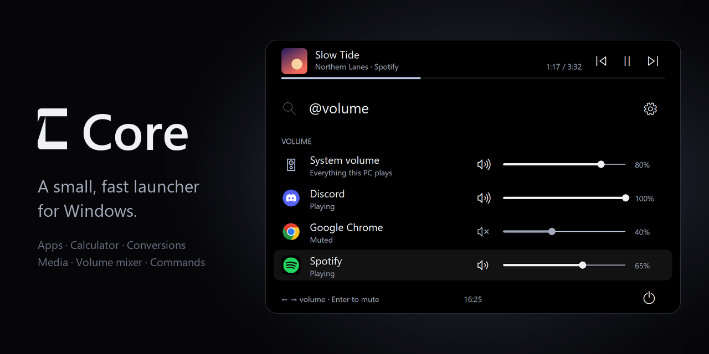

# Core

A native Windows launcher for applications, commands, calculations, and media controls.

Core brings app search, quicklinks, unit and currency conversions, shell commands, music controls, and per-application volume into one keyboard-driven window. It is written in Rust and requires no account.



## Installation

Requires **64-bit Windows** and the **Microsoft Visual C++ runtime for x64**.

1. Download `Core-Setup-<version>.exe` from the [latest public release](https://github.com/pleiades-org/Core/releases/latest).
2. Run the installer. Core installs for the current Windows account without an administrator prompt.
3. Press **Ctrl+Alt+Space** to open the launcher.

A portable ZIP is available from the same release page; extract it and run `core-v2.exe`. The setup file currently has no publisher certificate, so Windows may display a SmartScreen warning. Close an existing Core instance from its tray menu before installing or uninstalling.

Uninstall through **Windows Settings → Apps → Installed apps**. User settings are retained.

## Everyday use

| Action | Shortcut |
| --- | --- |
| Open or hide Core | Ctrl+Alt+Space |
| Select a result | ↑ / ↓ |
| Open, copy, or run the selected result | Enter |
| Hide the launcher | Esc or click outside |
| Open settings | Ctrl+, |
| Delete the previous word | Ctrl+Backspace |

The footer describes the selected action. Opening Core with an empty query shows recent applications. The tray menu provides access to the launcher, settings, and exit. The activation shortcut is configurable.

## Search and commands

| Example | Result |
| --- | --- |
| `code`, `vsc`, `studio code` | Find applications by name, word prefix, or initials |
| `cmd`, `wt`, `taskmgr` | Resolve familiar Windows application names |
| `> docs`, `@quicklink docs` | Find saved quicklinks |
| `2 + 3 * 4`, `sqrt(81)`, `25% of 80` | Calculate and copy results |
| `10 kg to lb`, `4.7GB to MiB` | Convert units and data sizes |
| `100 usd to eur`, `£50 in dollars` | Convert currencies using ECB reference rates |
| `2 days from now`, `9pm et to uk` | Calculate dates and convert time zones |
| `@web rust windows` | Search the web in the default browser |
| `@run notepad`, `shell:startup` | Open Windows Run targets |
| `/ipconfig /all` | Run a shell command in Core's terminal |

Type `@` to browse command scopes. Shell commands support **Ctrl+Enter** for an external terminal and **Ctrl+Shift+Enter** for an elevated terminal. Power actions such as sleep, restart, and shutdown require confirmation.

### Media and volume

Use `play`, `pause`, `next`, `previous`, `shuffle`, and `repeat` to control compatible Windows media sessions. `@media` lists available players; `@volume` or `@mix` opens the volume mixer.

The now-playing bar provides artwork, track progress, and transport controls. Hover over the artwork for player volume. In the mixer, use **↑ / ↓** to select a row, **← / →** to adjust volume, and **Enter** to toggle mute. Player support determines which transport options are available.

### Spotify search

`@song`, `@album`, `@artist`, and `@playlist` require an optional Spotify connection and Spotify Premium:

1. Create a Web API application in Spotify's developer dashboard.
2. Add the redirect URI `http://127.0.0.1:43821/callback` and copy the Client ID. Core does not require a client secret.
3. Add the Spotify account to the application's permitted users if required by its access settings.
4. Open **Settings → Music → Spotify song search**, enable it, and enter the Client ID.
5. Select **Connect Spotify** and approve access in the browser.

Keep Spotify active on an available playback device. `@playlist` lists library playlists and filters them by name. Existing connections may need authorization again when playlist access is added. After selecting an album, artist, or playlist with **↑ / ↓**, use **→** to reach shuffle/repeat actions and **←** to return to the result.

Standard Windows media controls and the volume mixer work without a Spotify developer application.

## Configuration

Settings save automatically. Configure appearance, window position, activation behavior, startup, the command shell, preferred player, and media shortcuts from **Ctrl+,** or the tray menu.

### Aliases

Aliases replace the first complete word of a query and preserve the remaining text. For example, map `d` to `Discord`, `@s` to `@song`, or `ip` to `/ipconfig /all` in **Settings → Aliases**.

### Quicklinks

Save websites, local paths, folders, and application links in **Settings → Quicklinks**. Search by their names or type `>` to list them. Examples include `https://github.com`, `C:\Projects`, and `steam://rungameid/2379780`.

## Updates and privacy

Core can check GitHub for updates when opened, at most once a day, download a signed update, and apply it after exit. Update verification uses Core's own signing key; this is separate from a Windows publisher certificate. Failed startup can trigger rollback. Update behavior is configurable as automatic, notify-only, or off.

Application search, calculations, unit conversions, and time-zone conversion run locally. Network access is used for GitHub updates, ECB currency rates, website quicklink icons, and connected Spotify features. Google's favicon service receives the domain names of eligible website quicklinks; local-network addresses are excluded.

There is no telemetry or required account. Settings, history, and logs are stored under `%APPDATA%\Pleiades\Core\v2`; caches use local application data.

## Build from source

Requires Windows, the **Rust 1.95.0 MSVC toolchain** pinned in `rust-toolchain.toml`, Visual Studio C++ Build Tools, and a Windows SDK. The workspace contains `crates/engine` for search and calculations and `crates/launcher` for the native application.

```powershell
git clone https://github.com/pleiades-org/Core.git
cd Core
```

```powershell
cargo build --release --locked -p core-launcher-v2 --bin core-v2
cargo test --locked --workspace
cargo clippy --locked --workspace --all-targets -- -D warnings
```

The executable is `target\release\core-v2.exe`. The `--dry-run` option allows interface testing without launching applications, writing to the clipboard, or registering shortcuts.

Release packaging and native verification scripts live in `scripts/`. Native checks open application windows and write records under `docs/measurements/`; create that directory before running the harnesses. These checks require an interactive Windows desktop.

## Troubleshooting and limitations

- **Shortcut conflict:** open Core from the tray and change the activation shortcut in Settings.
- **New application missing:** restart Core to refresh application discovery.
- **Spotify search unavailable:** check authorization, account access, Premium status, and the active playback device.
- **Diagnostics:** inspect `%APPDATA%\Pleiades\Core\v2\core.log` and include the query and observed behavior when reporting a problem.

The released application does not provide typo correction.

Screen readers, mixed display scaling, and some input methods are not fully covered by automated checks. Report reproducible issues in the [public issue tracker](https://github.com/pleiades-org/Core/issues).

## Command reference

<details>
<summary>Complete command reference</summary>

| Type | What happens |
| --- | --- |
| Nothing | Your recently used apps as a grid, up to 18. Arrow keys move, Enter or a click opens |
| `code`, `vsc`, `studio code`, `xbox` | Apps from the Start menu and the Microsoft Store, by name, word start, initials or any part of the name |
| `cmd`, `wt`, `taskmgr`, `regedit` | Apps by Windows' own short names: `cmd` finds Command Prompt and `wt` finds Windows Terminal |
| `@app calculator` | Apps only |
| `> docs`, `@quicklink docs` | Your quicklinks. Their names also appear in normal search |
| `2 + 3 * 4`, `@calc 25% of 80` | A sum. Enter copies the answer |
| `sqrt(81)`, `round(2.6)`, `pi*2` | Maths functions and constants |
| `time`, `date` | The time or date now. Enter copies it |
| `2 days from now`, `next Friday`, `3 hours ago` | Dates and times from today |
| `2028-01-31 + 1 month`, `2026-12-25 - 2026-09-21` | Date sums, and the days between two dates |
| `10 kg to lb`, `4.7GB to MiB`, `30 mpg to l/100km` | Units of 15 kinds, including data sizes and speeds |
| `100 usd to eur`, `£50 in dollars`, `100 usd` | Currency. An amount on its own converts to your own currency |
| `10 GB at 100 Mbps`, `10 GB in 10 min`, `100 Mbps for 2 hours` | Download time, the speed you need, and data used |
| `5 km in 25 min`, `26.2 mi in 3:30:00` | Running pace and speed |
| `20% off 80`, `20 is what % of 80`, `% change from 50 to 75` | Percentages |
| `tip 15% on 80 split 4`, `split 120 3 ways` | Tips and split bills |
| `255 to hex`, `0xff`, `2024 to roman` | Number bases and Roman numerals |
| `#ff8800`, `rgb(255, 136, 0) to hex`, `hsl 210 50 40 to rgb` | Colours as HEX, RGB and HSL |
| `unix now`, `unix 1700000000` | Unix time |
| `1920x1080`, `ppi 2560x1440 27in` | Screen aspect ratio and pixel density |
| `mortgage 250k at 4.5% for 25 years`, `compound 1000 at 5% for 10 years` | Loan payments and savings growth |
| `bmi 70kg 175cm` | Body mass index |
| `9pm et to uk`, `@time 21:00 ET to UK` | Time zones: ET, CT, MT, PT, UK, Berlin, Sydney, Tokyo, India and UTC |
| `9pm et to uk on 2026-03-10` | Time zones on a particular date |
| `@web Rust & Windows` | A Google search in your browser |
| `@`, `@cal` | Lists or completes a command |
| `@power`, `power off`, `restart`, `sleep` | Power actions, each confirmed first |
| `/ipconfig /all` | A command in your shell. **↑** recalls earlier commands |
| `@cmd dir`, `@ps Get-Process`, `@pwsh …`, `@wsl ls`, `@bash ls` | A command in a particular shell |
| `@run notepad`, `shell:startup`, `ms-settings:display`, `%appdata%` | Anything Windows Run accepts, optionally as administrator |
| `taskbar`, `tb`, `@taskbar` | Shows the Windows taskbar on Core's display |
| `@media`, `@music`, `@media spotify next` | Media controls, for the chosen player or one you name |
| `play`, `pause`, `next`, `previous`, `now playing` | That media control straight away. Core stays open for another press |
| `shuffle`, `repeat`, `loop`, `@media spotify shuffle` | Shuffle on or off, or repeat's next setting, for a player that lets Windows change them |
| `@volume`, `@mix`, `@mix spot` | The volume mixer, or only the programs whose name matches |
| `@song basorexia` | Spotify song search, once connected |
| `@album absolution`, `@artist muse` | Spotify album and artist search. Enter plays the chosen one; after **↑** or **↓**, **→** then Enter plays it shuffled or on repeat |
| `@playlist`, `@playlists`, `@playlist chill` | Your Spotify playlists, narrowed by what you type. Enter plays the chosen one; after **↑** or **↓**, **→** then Enter plays it shuffled or on repeat |
| `@update` | Checks for and installs updates |
| `@info`, `@about`, `@version` | Core's version, the latest release and this version's release notes |

Sums follow the usual order: `2+3*4` is 14 and `(2+3)*4` is 20. `%` divides by 100, so `25% of 80` is 20 and `20 + 10%` is 20.1.

</details>
